# Práctica: Administración de Contenedores con Dokploy

**Universidad del Quindío**  
**Facultad de Ingeniería de Sistemas y Computación**  
**Curso:** Administración de Infraestructura de TI  

**Estudiante:** Esteban Gómez León  
**Entorno de práctica:** Kali Linux sobre WSL 2 (local)

---

## Objetivo de la entrega

Documentar el despliegue y administración de una aplicación completa con Dokploy (PaaS auto-alojable), siguiendo las fases definidas en la guía de la práctica. Se incluyen capturas de cada etapa y se detallan las limitaciones encontradas por el entorno local.

---

## FASE 1 – Instalación y Configuración de Dokploy

Se instaló Dokploy mediante el script oficial (`curl -sSL https://dokploy.com/install.sh | sh`).  
Se verificó la correcta creación de los contenedores de **Dokploy** y **Traefik**, así como la exposición de los puertos 80, 443 y 3000.

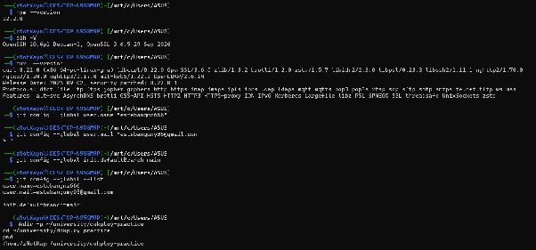
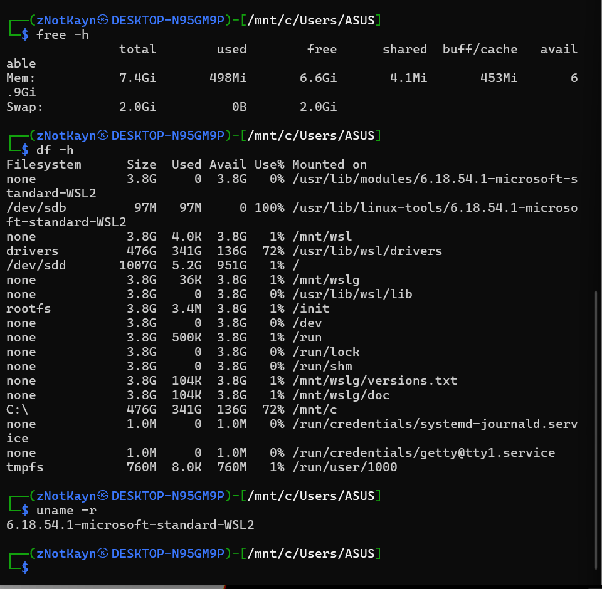
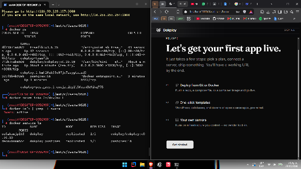

---

## FASE 2 – Exploración de la Interfaz y Primeros Pasos

Se exploró el dashboard principal y se creó el proyecto **uni-quindio**.  
Se preparó el repositorio de la aplicación Express.js y se subió a GitHub.

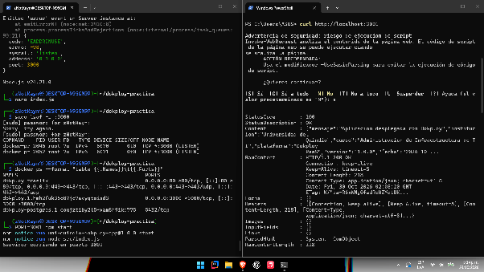
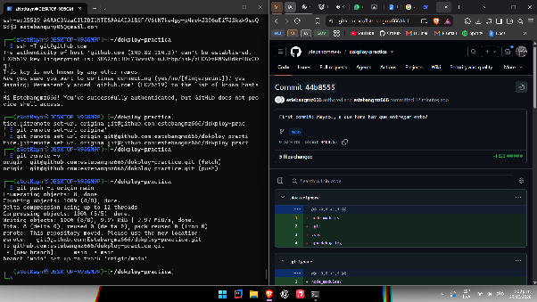

---

## FASE 3 – Despliegue de Aplicación con Dokploy

Se creó la aplicación **webapp-uni-quindio** conectada al repositorio Git.  
Dokploy detectó automáticamente Node.js (Nixpacks), construyó la imagen y desplegó el contenedor.  
Se configuraron variables de entorno y se verificó el acceso a través de la URL generada por Traefik.

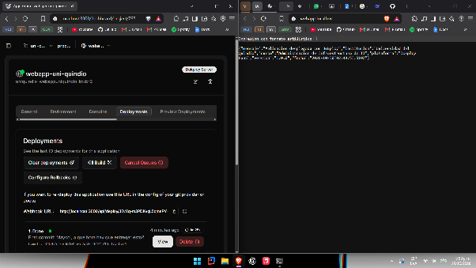
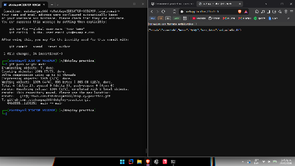
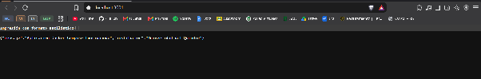

**Aplicación Node.js en ejecución**

---

## FASE 4 – Creación y Gestión de Bases de Datos

Se crearon y verificaron las siguientes bases de datos dentro del mismo proyecto:

| Tipo        | Nombre                  | Estado |
|-------------|-------------------------|--------|
| MySQL       | db-uni-quindio          | Activa |
| PostgreSQL  | db-postgres-quindio     | Activa |
| Redis       | redis-cache-quindio     | Activa |

Se obtuvieron las cadenas de conexión y se configuraron las variables de entorno en la aplicación para conectar con MySQL.

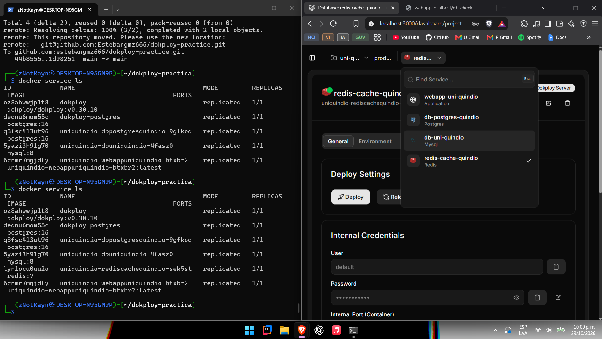

---

## FASE 5 – Docker Compose con Dokploy

Se creó el proyecto **multi-service** y se desplegó un `docker-compose.yml` que incluye:

- Aplicación Node.js
- MongoDB
- MySQL
- phpMyAdmin

**MongoDB en Compose**

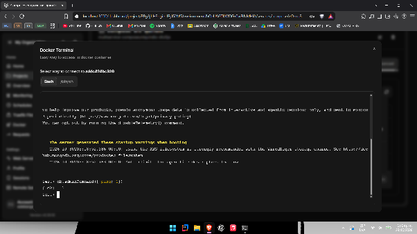

**MySQL + phpMyAdmin**

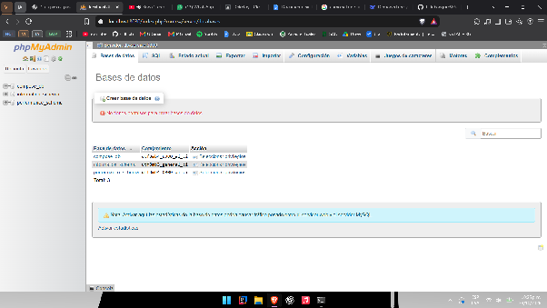

**Contenedores activos (`docker ps`)**

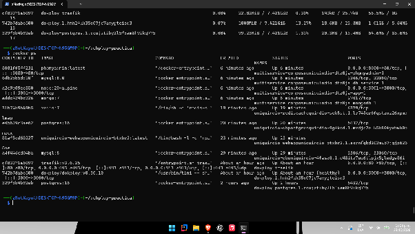

---

## FASE 6 – Monitoreo, Logs y Mantenimiento

Se revisaron logs en tiempo real y métricas de recursos (CPU, memoria, disco y red) tanto de la aplicación individual como de los servicios del Docker Compose.

**Logs – MultiService**

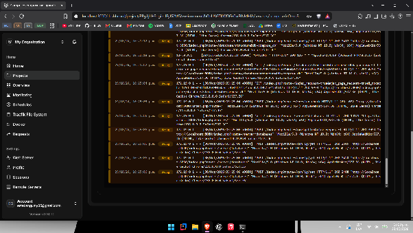

**Monitoreo – MultiService**

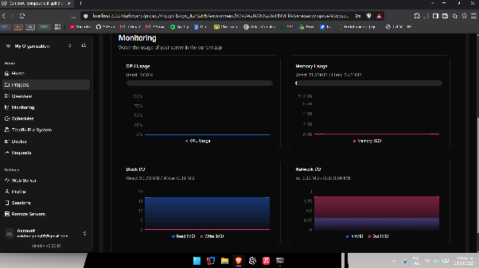
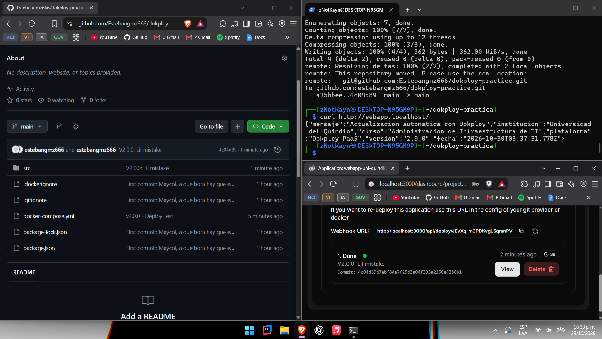

---

## FASE 7 – Git Integration y Despliegue Continuo

Se configuró la integración con el repositorio GitHub y se realizaron despliegues manuales desde la interfaz de Dokploy.

### Limitaciones encontradas

#### 1. Respaldos automáticos

No se implementaron los respaldos automáticos porque la práctica se realizó en un entorno local (Kali Linux sobre WSL 2) sin infraestructura de almacenamiento S3 configurada.

Aunque era posible utilizar MinIO como solución local, esta configuración adicional quedó fuera del alcance de la implementación.

Se lograron desplegar y verificar las bases de datos, pero la configuración y ejecución de respaldos automáticos quedó pendiente.

#### 2. Despliegue continuo automático (webhook)

No se implementó el despliegue automático por *push* debido a las limitaciones de conectividad del entorno local.

Dokploy estaba instalado en Kali Linux mediante WSL 2 y era accesible únicamente desde `localhost`. Al intentar configurar la integración mediante GitHub App, GitHub rechazó el webhook porque la dirección no era públicamente accesible.

Como alternativa se utilizó la integración con Git para obtener el código desde GitHub y ejecutar los despliegues **manualmente** desde la interfaz de Dokploy.

De esta manera se demostró el despliegue de aplicaciones desde un repositorio remoto, aunque no la automatización completa mediante webhooks.

---

## Resumen de entregables

| Entregable                          | Estado      | Observaciones                                      |
|-------------------------------------|-------------|----------------------------------------------------|
| Instalación de Dokploy              | Completado  | Contenedores Dokploy + Traefik operativos          |
| Aplicación Node.js desplegada       | Completado  | Accesible vía Traefik                              |
| Bases de datos (MySQL, PG, Redis)   | Completado  | Creadas y verificadas                              |
| Docker Compose multi-servicio       | Completado  | Mongo + MySQL + phpMyAdmin                        |
| Monitoreo y logs                    | Completado  | Capturas incluidas                                 |
| Git Integration                     | Parcial     | Despliegue manual (limitación de webhook local)    |
| Backups automáticos                 | Pendiente   | Entorno local sin S3                               |

---

## Conclusiones

La práctica permitió comprender la arquitectura de Dokploy (Docker Swarm + Traefik), el flujo de despliegue desde Git y la gestión unificada de aplicaciones, bases de datos y servicios multi-contenedor a través de una interfaz web.

Las limitaciones encontradas están directamente relacionadas con el entorno de desarrollo local (WSL 2). En un VPS con IP pública y puertos expuestos, tanto los webhooks de GitHub como los respaldos a S3 se habrían podido configurar sin inconvenientes.
